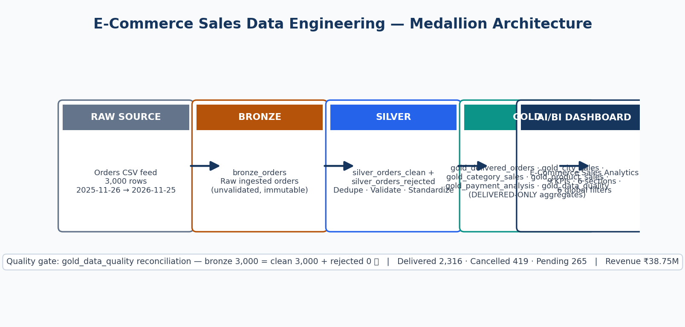

# E-Commerce Sales Data Engineering — Medallion Architecture on Databricks

An end-to-end data engineering portfolio project that ingests raw e-commerce order data into a
Unity Catalog **Bronze** layer, cleans and validates it into **Silver**, aggregates delivered-order
facts into **Gold**, and serves it through an **AI/BI Dashboard** with six global filters.



## Project Overview

| Layer | Table | Grain | Rows |
|---|---|---|---|
| Bronze | `workspace.ecommerce.bronze_orders` | raw order | 3,000 |
| Silver | `workspace.ecommerce.silver_orders_clean` | standardized order | 3,000 |
| Silver | `workspace.ecommerce.silver_orders_rejected` | quarantined invalid order | 0 |
| Gold | `workspace.ecommerce.gold_delivered_orders` | delivered order | 2,316 |
| Gold | `workspace.ecommerce.gold_city_sales` / `gold_category_sales` / `gold_product_sales` / `gold_payment_analysis` | aggregate | 8 / 4 / 26 / 5 |
| Quality | `workspace.ecommerce.gold_data_quality` | reconciliation snapshot | 1 |

## Medallion Architecture

- **Bronze** — raw ingestion (`01_bronze_ingestion.py`): the raw feed lands as-is (3,000 orders,
  2025-11-26 → 2026-11-25) including the audit-only `unit_price` column.
- **Silver** — cleaning (`02_silver_cleaning.py`): duplicate `order_id` detection, amount/quantity
  validation, missing-city checks, and text standardization; invalid rows are quarantined with a
  `reject_reason` into `silver_orders_rejected`. A reconciliation snapshot is written to
  `gold_data_quality` (bronze 3,000 = clean 3,000 + rejected 0 → `reconciliation_passed = true`).
- **Gold** — business aggregates (`03_gold_aggregation.py`): all five gold tables aggregate
  **delivered orders only**; lifecycle metrics (Total / Cancelled / Pending) use all valid
  statuses (Delivered, Cancelled, Pending).
- **Serving** — AI/BI dashboard `E-Commerce Sales Analytics | Gold Layer` with KPI cards,
  city/category/product/payment views, order-lifecycle analysis and a data-quality section.

## Tech Stack

- **Databricks** (notebooks + Serverless compute)
- **PySpark** for ingestion, cleaning and aggregation
- **Unity Catalog** three-level namespacing (`workspace.ecommerce.*`), managed Delta tables
- **AI/BI Dashboards** for the serving layer (per-section global filters: date, city, category,
  product, payment mode, order status)

## How to Run

1. Attach a cluster (or Serverless) with Unity Catalog access to `workspace.ecommerce`.
2. Run the notebooks in order:
   1. `notebooks/01_bronze_ingestion.py` — land raw orders into `bronze_orders`.
   2. `notebooks/02_silver_cleaning.py` — dedupe/standardize into `silver_orders_clean`,
      quarantine rejects, write the reconciliation snapshot.
   3. `notebooks/03_gold_aggregation.py` — build the five delivered-only gold tables.
3. `sql/` contains the **actual DDL** of the five gold tables (`SHOW CREATE TABLE` output).
4. Point an AI/BI dashboard at the gold tables (see `documentation/project_workflow.md`).

## Key Results (verified on the dashboard)

| KPI | Value |
|---|---|
| Total Orders | 3,000 |
| Delivered Orders | 2,316 |
| Cancelled Orders | 419 |
| Pending Orders | 265 |
| Total Revenue (delivered) | ₹38,752,602 (₹38.75M) |
| Average Order Value | ₹16,732.56 |
| Units Sold | 5,798 |
| Delivery Rate | 77.2% |
| Cancellation Rate | 14.0% |

Reconciliation: 2,316 + 419 + 265 = 3,000 exactly; sum of `gold_city_sales.revenue`
= 38,752,602 = total delivered revenue. Zero duplicate order IDs, zero rejected rows.

## Repository Layout

```
E-Commerce-Sales-Data-Engineering/
├── README.md
├── architecture/medallion_architecture.png
├── data/README.md
├── notebooks/            # reference PySpark implementations of the pipeline
├── sql/                  # real DDL of the five gold tables
├── dashboard/            # dashboard screenshot + PDF export
├── documentation/        # data dictionary, data quality, project workflow
└── screenshots/          # layer previews and dashboard captures
```
